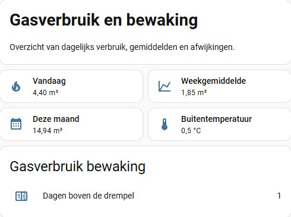
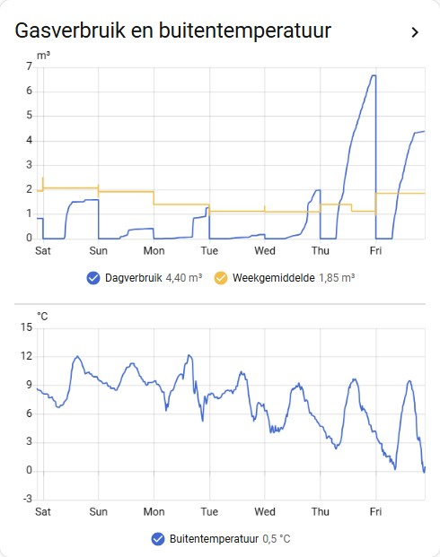

[Nederlands](README.md) |
|:---:|


[](https://www.home-assistant.io/)
[](Automations.yaml)
[](Dashboard.yaml)

# Afwijkend gasverbruik monitor voor Home Assistant

<p align="center">
  
</p>

<p align="center">
  
</p>

# Wat doet deze automatisering?

Deze automatisering bewaakt het dagelijkse gasverbruik en vergelijkt dit met het gemiddelde van de afgelopen zeven dagen.
Het systeem probeert niet direct een gaslek te detecteren, maar signaleert afwijkend gasverbruik.
Wanneer het actuele verbruik aanzienlijk hoger ligt dan normaal ontvang je een waarschuwing.

Hiermee kun je onder andere ontdekken:

- onbedoeld hoog stookgedrag
- een cv-installatie die meer verbruikt dan gebruikelijk
- veranderingen in warmwatergebruik
- foutieve instellingen van verwarming of thermostaat
- mogelijke lekkages of defecten die leiden tot extra gasverbruik


# Hoe werkt het?

## Stap 1 - Dagverbruik bewaren

Iedere avond wordt het dagverbruik opgeslagen in een reeks helpers:

```text
gas1 = gisteren
gas2 = eergisteren
gas3 = 3 dagen geleden
...
gas7 = 7 dagen geleden
```

Bij iedere nieuwe dag schuiven alle waarden één positie op.

Voorbeeld:

```text
Vandaag     3,5 m³
Gisteren    3,1 m³
Dag -2      2,9 m³
Dag -3      3,2 m³
Dag -4      3,0 m³
Dag -5      2,8 m³
Dag -6      3,3 m³
```

## Stap 2 - Weekgemiddelde berekenen

Van deze zeven waarden wordt een gemiddelde berekend.

Voorbeeld:

```text
3,5 + 3,1 + 2,9 + 3,2 + 3,0 + 2,8 + 3,3 = 21,8

21,8 / 7 = 3,11 m³
```

Het weekgemiddelde bedraagt dan:

```text
3,11 m³ per dag
```

Dit gemiddelde vormt de basis voor alle verdere controles.


## Stap 3 - Alarmdrempel bepalen

De alarmdrempel bepaalt wanneer het systeem een gasverbruik als afwijkend beschouwt.

De drempel wordt berekend met:

```text
Alarmdrempel = Weekgemiddelde × Factor
```

In deze automatisering is de standaardfactor:

```text
1,25
```

oftewel:

```text
125%
```

Dat betekent dat het dagverbruik pas als afwijkend wordt gezien wanneer het meer dan 25% boven het gemiddelde van de afgelopen week ligt.


## Voorbeeld

Weekgemiddelde:

```text
4,0 m³
```

Factor:

```text
1,25
```

Alarmdrempel:

```text
4,0 × 1,25 = 5,0 m³
```

Pas boven:

```text
5,0 m³
```

wordt een waarschuwing verstuurd.


## Waarom juist 1,25?

De waarde 1,25 is gekozen als een compromis tussen:

- Gevoelig genoeg om afwijkingen te ontdekken.
- Niet zo gevoelig dat er voortdurend meldingen ontstaan.

In de praktijk blijkt een afwijking van ongeveer 20% tot 30% vaak groot genoeg om interessant te zijn, terwijl normale dagelijkse schommelingen worden genegeerd.


## Wanneer de factor verhogen?

Verhoog de factor wanneer je te veel meldingen ontvangt.

Voorbeelden:

- sterk wisselende buitentemperaturen.
- veel variatie in warmwatergebruik.
- groot gezin met onvoorspelbaar verbruik.
- regelmatig logés of bezoekers.
- een woning waarin het verbruik van nature sterk schommelt.

Voorbeeld:

```text
1,25 → 1,40
```

Dan moet het verbruik:

```text
40% hoger
```

zijn voordat een melding wordt verstuurd.
Hierdoor ontvang je minder meldingen.


## Wanneer de factor verlagen?

Verlaag de factor wanneer je juist eerder gewaarschuwd wilt worden.

Voorbeelden:

- zeer stabiel gasverbruik.
- kleine woning.
- geen grote schommelingen in leefpatroon.
- je wilt afwijkingen zo snel mogelijk signaleren.
- je gebruikt het systeem specifiek om subtiele veranderingen te ontdekken.

Voorbeeld:

```text
1,25 → 1,15
```

Dan is slechts:

```text
15% afwijking
```

voldoende voor een waarschuwing.
Hierdoor ontvang je eerder meldingen.


## Richtlijn voor instellingen

| Factor | Gevoeligheid | Toepassing |
|----------|----------|----------|
| 1,10 | Zeer hoog | Zeer stabiel verbruik |
| 1,15 | Hoog | Snelle detectie gewenst |
| 1,25 | Normaal | Aanbevolen standaard |
| 1,35 | Lager | Meer schommelingen toegestaan |
| 1,50 | Laag | Alleen grote afwijkingen melden |


## Benodigde helpers

Deze automatisering gebruikt een aantal helpers om historische gegevens en tellerstanden op te slaan.


## Dagverbruik historie

Maak de volgende `input_number` helpers aan:

```yaml
input_number:
  naam: gas1
    min: 0
    max: 500
    step: 0.01
```

Dit doe je voor:

- gas1
- gas2
- gas3
- gas4
- gas5
- gas6
- gas7

Deze helpers bevatten het gasverbruik van de afgelopen zeven dagen.


## Teller voor aanhoudend hoog verbruik

Maak een counter aan:

```yaml
counter:
  naam: gas boven gemiddelde dagen
    step: 1
    restore: true
```

Deze teller houdt bij hoeveel dagen achter elkaar het dagverbruik boven de alarmdrempel ligt.


## Helpers voor maand gemiddelden

Voor het opslaan van maandgemiddelden zijn twaalf helpers nodig.

Voorbeeld:

```yaml
input_number:
  naam: gem januari 2
    min: 0
    max: 100
    step: 0.1
```

Maak vervolgens ook:

- gem februari 2
- gem maart 2
- gem_april_2
- gem mei 2
- gem juni 2
- gem juli 2
- gem augustus 2
- gem september 2
- gem oktober 2
- gem november 2
- gem december 2

Hierin wordt aan het einde van iedere maand het gemiddelde dagelijkse gasverbruik opgeslagen.


# Utility meters

```text
sensor.daily_gasverbruik
```

Dit is een Utility Meter die bij mij wordt gevuld door de P1-meter en dagelijks wordt gereset.

Eigenschappen:

- verbruik in m³
- dagelijkse reset
- geeft het totale gasverbruik van vandaag weer


## Maandelijks gasverbruik

```text
sensor.monthly_gasverbruik
```

Dit is een Utility Meter die bij mij wordt gevuld door de P1-meter en maandelijks wordt gereset.

Eigenschappen:

- verbruik in m³
- maandelijkse reset
- geeft het totale gasverbruik van de huidige maand weer

Wordt gebruikt voor:

- maandgemiddelden
- logging
- historische analyses


## Buitentemperatuur

```text
sensor.temperatuur
```

Deze kun je bijvoorbeeld gebruiken van Buienradar of een eigen weersensor.
De temperatuur wordt mee opgeslagen in Google Sheets zodat afwijkend gasverbruik later eenvoudiger verklaard kan worden.

Voorbeelden:

- hoog gasverbruik + lage temperatuur → vaak normaal
- hoog gasverbruik + hoge temperatuur → mogelijk afwijkend
- laag gasverbruik + lage temperatuur → efficiënt verwarmgedrag


# Optionele integraties

De volgende integratie is niet verplicht, maar wel aanbevolen.

## Google Sheets

Wordt gebruikt om dagelijks gegevens op te slaan voor:

- trendanalyse
- vergelijking per seizoen
- controle van meldingen
- historische rapportages

Wanneer je Google Sheets niet gebruikt, kun je de logging-automation eenvoudig uitschakelen zonder dat andere functies verloren gaan.


## Hoe weet ik of de factor goed staat?

Laat de automatisering eerst enkele weken draaien zonder wijzigingen.
Stel jezelf daarna de volgende vragen:

### Te veel meldingen?

- verhoog de factor.
- bijvoorbeeld van 1,25 naar 1,35 of 1,40.

### Vrijwel nooit meldingen?

- verlaag de factor.
- bijvoorbeeld van 1,25 naar 1,15.

### Afwijkingen worden precies op het juiste moment gemeld?

- Laat de factor ongewijzigd.

Ik denk dat het voor de meeste gebruikers:

```text
1,25
```

een uitstekend uitgangspunt is.

Het biedt een balans tussen:

- gevoeligheid
- betrouwbaarheid
- weinig valse meldingen

Pas de factor pas aan nadat je voldoende historische gegevens hebt verzameld en weet hoe jouw woning zich gedurende verschillende weersomstandigheden gedraagt.
Een lagere factor betekent niet automatisch een betere detectie.
Het doel van deze automatisering is niet om zoveel mogelijk meldingen te genereren, maar om afwijkingen te signaleren die daadwerkelijk aandacht verdienen.
Gebruik de ontvangen meldingen om de gevoeligheid geleidelijk af te stemmen op jouw eigen woning, stookgedrag en gezinssituatie.


## Stap 4 - Hoog verbruik detecteren

Wanneer het actuele dagverbruik boven de alarmdrempel komt, wordt hiervan een melding verstuurd.

Voorbeeld:

```text
Weekgemiddelde: 3,11 m³
Alarmdrempel:   3,89 m³
Vandaag:        4,60 m³
```

Resultaat:

```text
Waarschuwing: Hoog gasverbruik
```


## Stap 5 - Opeenvolgende dagen tellen

Een enkele afwijkende dag hoeft geen probleem te zijn.
Misschien was het buiten gewoon erg koud of waren er gasten aanwezig.
Daarom telt het systeem ook hoeveel dagen achter elkaar het verbruik boven de alarmdrempel ligt.

Voorbeeld:

```text
Dag 1  boven drempel
Dag 2  boven drempel
Dag 3  boven drempel
```

Na drie opeenvolgende dagen wordt een extra waarschuwing verstuurd.
Deze melding wijst erop dat er mogelijk een structurele oorzaak aanwezig is.


# Detecteert dit een gaslek?

Niet direct.
De automatisering detecteert geen gaslekkage, maar signaleert afwijkend gasverbruik. Dit kan wijzen op een mogelijke gaslekkage, maar er kunnen ook andere oorzaken zijn. Denk bijvoorbeeld aan:

- kouder weer.
- vaker of langer douchen.
- een hogere thermostaatinstelling.
- logés of extra personen in huis.
- een defecte cv-installatie.
- een slecht afgestelde cv-ketel.

De melding is daarom bedoeld als een signaal om nader onderzoek te doen.


## Waarom wordt gekeken naar een weekgemiddelde?

Het gasverbruik verschilt sterk per seizoen.
Een vaste alarmgrens werkt daardoor vaak niet goed.

Voorbeeld:

```text
Zomerdag     0,8 m³
Winterdag    6,0 m³
```

Een vaste alarmgrens van:

```text
5 m³
```

zou in de zomer voortdurend meldingen geven en in de winter mogelijk nooit.
Door het actuele verbruik te vergelijken met het eigen weekgemiddelde past de alarmdrempel zich automatisch aan aan de omstandigheden.


## Waarom pas na drie dagen een extra waarschuwing?

Een enkele dag met hoog verbruik hoeft geen probleem te zijn.

Bijvoorbeeld:

- een koude dag.
- veel warmwatergebruik.
- een avond waarop de verwarming langer heeft aangestaan.

Wanneer het verbruik echter drie dagen achter elkaar verhoogd blijft, neemt de kans toe dat er iets structureels aan de hand is.
Daarom wordt dan een extra waarschuwing verstuurd.


# Veiligheidsinstructies

## Belangrijk om te weten

Deze automatisering is bedoeld als hulpmiddel voor het signaleren van afwijkend gasverbruik.

Het systeem is:

- geen gasmelder
- geen lekdetector
- geen veiligheidsvoorziening
- geen vervanging voor professionele detectiesystemen

Een melding van deze automatisering betekent uitsluitend dat het gasverbruik afwijkt van het normale patroon.


## Wat te doen bij een vermoeden van een gaslek?

Wanneer je één of meer van onderstaande situaties herkent:

- je ruikt gas in huis.
- je hoort een sissend geluid bij een leiding of koppeling.
- je gasmeter registreert verbruik terwijl alle gastoestellen uitgeschakeld zijn.
- het gasverbruik neemt plotseling en onverklaarbaar sterk toe.

Volg dan altijd de officiële veiligheidsrichtlijnen.

### Veiligheidsmaatregelen

- draai indien mogelijk de hoofdkraan van het gas dicht.
- open ramen en deuren om te ventileren.
- vermijd open vuur.
- vermijd vonken.
- bedien geen elektrische schakelaars.
- gebruik geen elektrische apparaten.
- gebruik geen apparatuur die een vonk kan veroorzaken.
- waarschuw aanwezige personen.

Neem vervolgens contact op met:

- je netbeheerder
- de storingsdienst
- de hulpdiensten wanneer sprake is van een acute gevaarlijke situatie


## Entity-ID's aanpassen

De entity-ID's in dit project zijn voorbeelden uit mijn eigen Home Assistant-installatie. Vervang deze door de overeenkomstige entity-ID's uit jouw eigen installatie. Controleer daarbij alle YAML-bestanden, inclusief de templates, automatiseringen en het dashboard. Let ook op de gebruikte notificatieservices en helpers.

Hoe je dit eenvoudig kunt doen, lees je in mijn aparte handleiding: [Entities – Entity-ID's aanpassen](https://github.com/henkhoekema/Entities).


## Disclaimer

De auteur van deze automatisering aanvaardt geen aansprakelijkheid voor schade, letsel, gevolgschade of gemiste meldingen.
Gebruik deze automatisering uitsluitend als aanvullend hulpmiddel voor monitoring en analyse van gasverbruik.

Voor gasveiligheid dienen altijd geschikte gasmelders, periodiek onderhoud en de officiële veiligheidsrichtlijnen te worden gevolgd.

## Licentie en gebruiksvoorwaarden

Deze automatisering mag vrij worden gebruikt en aangepast voor eigen gebruik.

Bij het publiceren, verspreiden of delen van deze deze automatisering, of van geheel of gedeeltelijk daarop gebaseerde aangepaste versies, is bronvermelding verplicht. Daarbij moet de oorspronkelijke auteur worden vermeld en moet, waar redelijkerwijs mogelijk, een verwijzing naar de oorspronkelijke repository worden opgenomen.

Het is niet toegestaan deze automatisering of afgeleide versies als volledig eigen oorspronkelijk werk te presenteren zonder de oorspronkelijke auteur te erkennen.

Deze automatisering wordt aangeboden zonder enige garantie. Gebruik en aanpassing geschieden op eigen risico. Voor zover wettelijk toegestaan aanvaardt de auteur geen aansprakelijkheid voor schade die voortvloeit uit het gebruik of de aanpassing ervan.


